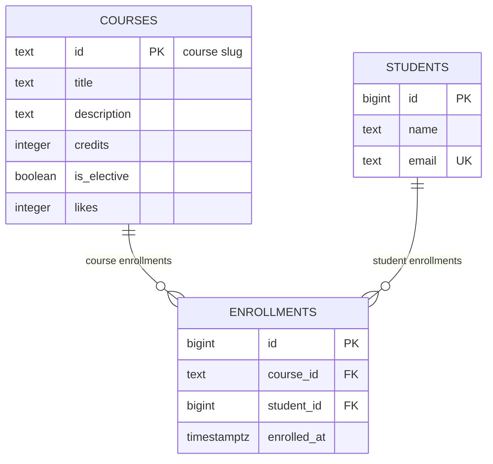

# course-catalog-db

PostgreSQL schema for the course catalog (Lab 6, "Advanced Web Technologies").

## How to run

PostgreSQL 16 or newer is required. Once, as the `postgres` superuser:

```sql
CREATE ROLE catalog_app LOGIN PASSWORD 'change-me';
CREATE DATABASE course_catalog OWNER catalog_app;
```

Then, from the project folder (it stops at the first error):

```bash
psql -h localhost -U catalog_app -d course_catalog -v ON_ERROR_STOP=1 -f schema.sql
psql -h localhost -U catalog_app -d course_catalog -v ON_ERROR_STOP=1 -f seed.sql
psql -h localhost -U catalog_app -d course_catalog -v ON_ERROR_STOP=1 -f queries.sql
```

The password `change-me` is for teaching; real projects keep passwords out of git.

## Schema



The database schema models an academic course catalog comprising three relational tables: `courses`, `students`, and `enrollments`. The domain exhibits a many-to-many relationship between students and courses, as a student can register for multiple courses and a course can be attended by multiple students. This many-to-many relationship is normalized through the `enrollments` junction table, which associates student records with course records via foreign keys while ensuring each student can enroll in a given course at most once.

## Design decisions

- **Why `courses.id` is `text` (a slug) while `students.id` is an automatic number:**
  A slug identifier (e.g. `modern-frontend`) for courses provides clean, human-readable, and SEO-friendly RESTful API endpoints (`/courses/modern-frontend`) without requiring an extra slug column or index lookup. The disadvantage is that text keys consume more storage in foreign key references and indexes, and changing a course slug requires updating all referencing foreign keys. For students, names and emails can change, so a surrogate integer key (`bigint GENERATED ALWAYS AS IDENTITY`) provides a stable, compact (8 bytes), high-performance numeric identifier that never changes and simplifies index operations and joins.
- **Why `RESTRICT` on `enrollments.course_id` but `CASCADE` on `enrollments.student_id`:**
  A course is a central organizational unit; deleting a course while students are actively enrolled could silently delete student enrollment histories, transcripts, and financial/audit records. Using `ON DELETE RESTRICT` guards against accidental catalog deletions by requiring enrollments to be explicitly unassigned or archived first. On the other hand, if a student account is removed (for example, account deletion or GDPR request), their individual enrollments become obsolete and should be automatically pruned via `ON DELETE CASCADE` to prevent orphaned enrollment records.
- **Why `timestamptz` and not `timestamp`, and why `text` and not `varchar(n)`:**
  `timestamptz` (`timestamp with time zone`) stores the point in time in UTC internally and converts to/from client session time zones cleanly. Using `timestamp` without timezone loses timezone context and leads to timezone ambiguities across clients and servers. In PostgreSQL, `text` and `varchar` use identical internal representation (`varlena`) with identical performance; arbitrary length limits like `varchar(255)` introduce maintenance friction when valid inputs exceed the length, whereas explicit `CHECK` constraints (e.g. `CHECK (length(name) >= 2)`) allow precise business rule validation without locking types.

## Constraint violation log

Commands were run with `\set VERBOSITY verbose`.

| # | What we violate | SQLSTATE | Constraint | API response |
|---|-----------------|----------|------------|--------------|
| 1 | NULL in courses.title | 23502 | `title` (COLUMN NAME, NOT NULL has no constraint name) | 422 Unprocessable Entity (500 if Pydantic let it through due to a bug) |
| 2 | courses.credits = 0 | 23514 | `courses_credits_check` | 422 Unprocessable Entity |
| 3 | courses.likes = -1 | 23514 | `courses_likes_check` | 500 Internal Server Error (only server code increments likes via `likes + 1`; negative value indicates application bug) |
| 4 | a one-letter student name | 23514 | `students_name_check` | 422 Unprocessable Entity |
| 5 | a duplicate student email | 23505 | `students_email_key` | 409 Conflict |
| 6 | a duplicate course id | 23505 | `courses_pkey` | 409 Conflict |
| 7 | a repeated enrollment in a course | 23505 | `enrollments_course_id_student_id_key` | 409 Conflict |
| 8 | enrolling in a nonexistent course | 23503 | `enrollments_course_id_fkey` | 404 Not Found (course not found) |
| 9 | enrolling a nonexistent student | 23503 | `enrollments_student_id_fkey` | 404 Not Found (student not found) |
| 10 | deleting a course that has enrollments | 23503 | `enrollments_course_id_fkey` | 409 Conflict: a course with enrollments can't be deleted |
| 11 | deleting a student (cascade delete) | — (no error) | `enrollments_student_id_fkey` (ON DELETE CASCADE) | 204 No Content / 200 OK: student deleted; enrollments deleted by cascade, 6 → 3, 6 after ROLLBACK |

### Why check in the database if there is already a check in Pydantic?

Pydantic performs input validation at the FastAPI boundary, rejecting invalid payloads early with friendly client messages. However, the database is the single source of truth and final line of defense. The API is rarely the only client touching the database: direct SQL scripts, data migrations (Alembic), administrative consoles, and background workers can all write to PostgreSQL directly. Enforcing constraints at the database level guarantees data integrity regardless of how or by whom data is inserted.

## Index: EXPLAIN before and after

Query: `SELECT * FROM enrollments WHERE student_id = 777;`
Database idx_demo: 500 courses, 20,000 students, 50,000 enrollments.

| | Before the index | After the index |
|---|------------------|-----------------|
| Access method | Seq Scan | Bitmap Heap Scan / Bitmap Index Scan |
| cost | 0.00..1042.00 | 4.31..15.59 |
| Rows Removed by Filter | 49997 | 0 (none) |
| Execution Time | 4.858 ms | 0.007 ms |

```text
-- Before index
Seq Scan on enrollments  (cost=0.00..1042.00 rows=3 width=34) (actual time=0.097..4.846 rows=3 loops=1)
  Filter: (student_id = 777)
  Rows Removed by Filter: 49997
Planning Time: 0.062 ms
Execution Time: 4.858 ms
```

```text
-- After index
Bitmap Heap Scan on enrollments  (cost=4.31..15.59 rows=3 width=34) (actual time=0.003..0.004 rows=3 loops=1)
  Recheck Cond: (student_id = 777)
  Heap Blocks: exact=3
  ->  Bitmap Index Scan on enrollments_student_id_idx  (cost=0.00..4.31 rows=3 width=0) (actual time=0.002..0.002 rows=3 loops=1)
        Index Cond: (student_id = 777)
Planning Time: 0.012 ms
Execution Time: 0.007 ms
```

Answers to the questions:

1. **Why didn't PostgreSQL create an index on `enrollments.student_id`, although there are indexes on `email` and `course_id`?**
   PostgreSQL automatically creates unique B-tree indexes only for `PRIMARY KEY` and `UNIQUE` constraints (such as `students_email_key` and the composite `enrollments_course_id_student_id_key`). The composite index on `(course_id, student_id)` can only accelerate queries filtering by `course_id` (the first column in the composite index) or both columns together; it cannot be used for searches on `student_id` alone. PostgreSQL never creates indexes automatically for `FOREIGN KEY` constraints, so foreign key indexes must be created explicitly.

2. **Why does a primary-key lookup on `courses` (six rows) use `Seq Scan`, while on `enrollments` (50 thousand rows) it goes through an index?**
   The PostgreSQL cost-based query planner estimates the total cost of reading pages and processing rows. The `courses` table contains only 6 rows, fitting entirely on a single 8KB disk page. Reading that single page sequentially (cost ~1.07) is faster than traversing index tree pages and then reading the table heap page. On the other hand, `enrollments` has 50,000 rows spread across many pages; scanning all 50,000 rows costs 1042.00 arbitrary units and discards 49,997 rows, whereas index lookup costs only ~15.59. The planner chooses `Seq Scan` whenever it is cheaper than index access.

3. **Name two operations that an index on `student_id` will speed up:**
   - Looking up all enrollments of a specific student (`SELECT * FROM enrollments WHERE student_id = 777;`), which is used when viewing a student's profile or enrolled courses.
   - Deleting or updating a student with cascading foreign keys (`DELETE FROM students WHERE id = 777;`), where the engine must locate and remove matching child rows from `enrollments`.

## Transaction

Scenario: enroll a new student in a course — two inserts in one transaction.

- The second insert failed: psql showed `ERROR: 23503: insert or update on table "enrollments" violates foreign key constraint "enrollments_course_id_fkey"` with detail `Key (course_id)=(no-such-course) is not present in table "courses"`. The transaction entered the aborted state (`course_catalog=!>`), rejecting any further queries. Running `ROLLBACK;` cancelled the transaction completely, undoing the first insert as well: Madina was not added to the `students` table (`count = 0`).
- Window B saw `0` before COMMIT (changes made inside an active transaction are isolated and invisible to concurrent sessions under PostgreSQL's default `read committed` isolation level) and `1` after COMMIT (both rows became visible atomically).
- What would have happened without a transaction if the second insert had failed? Without a transaction (or under autocommit mode), each SQL statement runs as its own standalone transaction. The first insert would have permanently committed the student `Madina Ospanova` to the `students` table, while the second insert would fail. The database would be left in an inconsistent "half an operation" state containing an orphaned student who is enrolled in zero courses.

## Self-review against the checklist

| What to check | Result | Comment |
|---------------|--------|---------|
| Keys | Yes | Every table has a primary key (`courses.id`, `students.id`, `enrollments.id`), and `enrollments` has foreign keys referencing `courses(id)` and `students(id)`. |
| Types | Yes | Types match semantics: course slugs are `text`, numeric surrogate IDs are `bigint`, timestamps use `timestamptz`, numbers are `integer`, and booleans are `boolean`. |
| Required values | Yes | All columns across all three tables are `NOT NULL`, guaranteeing that required attributes are never NULL. |
| Constraints | Yes | Domain rules are enforced via `CHECK (credits > 0)`, `CHECK (likes >= 0)`, `CHECK (length(name) >= 2)`, `UNIQUE (email)`, and composite `UNIQUE (course_id, student_id)`, aligning with Pydantic validations. |
| Deletion | Yes | `ON DELETE RESTRICT` protects courses from accidental deletion while active enrollments exist; `ON DELETE CASCADE` automatically purges enrollments when a student is deleted. |
| Normalization | Yes | The schema is in 3NF: course details are stored once in `courses`, student details once in `students`, and the junction table `enrollments` models the M:N relationship with no duplicate attribute lists. |
| Indexes and names | Yes | All identifiers use consistent snake_case naming; foreign key `student_id` is indexed with `enrollments_student_id_idx` to accelerate lookups and cascading operations; no redundant indexes exist. |
